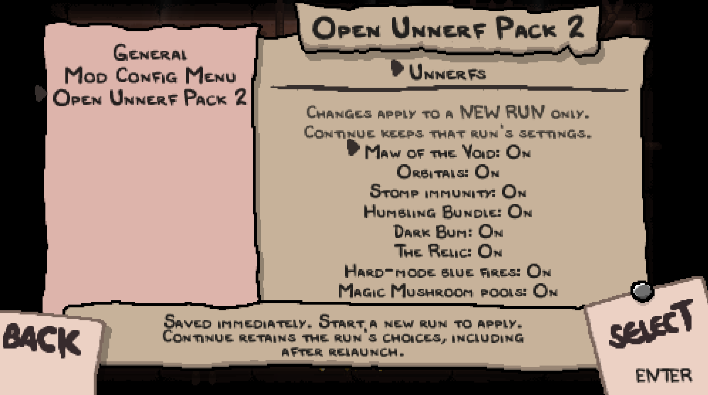

# Open Unnerf Pack 2

Open Unnerf Pack 2 restores selected item and mechanic buffs in **The Binding of
Isaac: Repentance+**. Choose the adjustments you want, or play with all supported
unnerfs enabled by default.

This is the maintained fork of [KeinNiemand's original Open Unnerf
Pack](https://github.com/KeinNiemand/Isaac-Repentence-Open-Unnerf-Pack), continued
by [Tyniann](https://github.com/Tyniann) with compatibility fixes, configurable
unnerfs, and updated documentation.

[Feature index](docs/features/README.md) · [Changelog](docs/CHANGELOG.md) ·
[Report a bug or suggest an adjustment](https://github.com/Tyniann/Isaac-Repentence-Open-Unnerf-Pack/issues)

## Features

The pack currently includes nine independently configurable adjustments:

- [Maw of the Void](docs/features/maw-of-the-void.md): restore bonus damage and
  black-heart drops from qualifying dark rings.
- [Orbitals](docs/features/orbitals.md): increase contact damage and collision
  size for qualifying orbital familiars.
- [Stomp immunity](docs/features/stomp-immunity.md): restore protection with
  Host Hat and Pyromaniac, including Pyromaniac healing on crush impacts.
- [Humbling Bundle](docs/features/humbling-bundle.md): turn eligible single
  hearts, pennies, keys, and bombs into double packs.
- [Dark Bum](docs/features/dark-bum.md): convert eligible pickup rewards into
  soul hearts, with character exclusions.
- [The Relic](docs/features/the-relic.md): adjust its room-clear counter for
  soul-heart generation.
- [Hard-mode blue and purple fires](docs/features/blue-fires.md): add an extra
  soul-heart chance on eligible explosion-damage events.
- [Magic Mushroom pools](docs/features/magic-mushroom.md): restore normal Boss
  availability and full normal Treasure weight, keeping the item's effects.
- [Void choice absorption](docs/features/void.md): absorb eligible items from
  ordinary linked choice groups while retaining Repentance+'s four-room charge.

The [feature reference](docs/features/README.md) explains each adjustment,
its restrictions, and its tested behavior. The Nail and Satanic Bible helpers
remain unfinished and disabled.

## Compatibility

The current target is **Repentance+ v1.9.7.17**. The original seven adjustments
and configuration have [recorded local Normal/Hard checks](docs/testing/issue-1-engine-results.md#acceptance-matrix).
Magic Mushroom has its own [pool and Continue validation](docs/testing/magic-mushroom-1.9.7.17.md).
Void choice absorption has separate [native matrix, Continue and charge checks](docs/testing/void-choice-1.9.7.17.md).
Each feature page explains its tested conditions and limits; other game builds,
Greed modes, and multiplayer have separate validation requirements.

## Installation

1. Close the game and download the `Open-Unnerf-Pack-2-vX.Y.Z.zip` asset from the
   [latest release](https://github.com/Tyniann/Isaac-Repentence-Open-Unnerf-Pack/releases/latest).
2. Extract its `Open Unnerf Pack 2` folder into your active Repentance+
   installation's `mods` directory. The layout should include
   `mods/Open Unnerf Pack 2/main.lua`, with `metadata.xml`, `config.lua`, `Mods/`,
   and `content/` directly inside the same pack folder.
3. Disable duplicate copies of the original pack or standalone versions of the
   same unnerfs. Launch the game, enable **Open Unnerf Pack 2** in the Mods menu,
   and start a new run.

For manual updates, close the game and replace the files in the same pack
folder, keeping its existing folder name if you used `open unnerf pack` before.
The release preserves the internal settings identifiers. Start a new run to
use changed content and new settings. To uninstall a manual copy, close the
game and remove that folder.

Use the named release asset above for installation; GitHub's automatic source
archives contain the development checkout. To package a source checkout or
prepare a Workshop upload, follow the [release guide](docs/agents/releasing.md).

## Configuration

All nine supported unnerfs default to **On**. To choose them individually,
install the optional [Mod Config Menu
Pure](https://steamcommunity.com/sharedfiles/filedetails/?id=2681875787). In game,
press **F10**, then select **Open Unnerf Pack 2 → Unnerfs**. The integration has
been validated with **MCM Pure v113**.

Settings save immediately and apply when you **start a new run**. Continuing a
saved run keeps that run's choices, even after restarting the game. Settings are
stored separately for each Isaac save slot. Without MCM, the pack uses saved
choices or its all-On defaults.

See the [configuration guide](docs/features/configuration.md) for menu controls,
Continue behavior, and saved-setting details.

## Bugs, suggestions, and contributions

Use [this fork's issue
tracker](https://github.com/Tyniann/Isaac-Repentence-Open-Unnerf-Pack/issues) for
bug reports and suggestions. For a bug, include the game version, pack revision,
enabled unnerfs and other mods, reproduction steps, and expected versus actual
behavior. A seed or console setup and relevant Lua errors help make reports
reproducible.

Contributions are welcome. Keep adjustments in their own modules under `Mods/`;
use `main.lua` for loading modules and shared pack behavior. Include appropriate
checks, feature documentation, and a [changelog](docs/CHANGELOG.md) entry for
user-visible changes. The [compatibility test
guide](docs/testing/repentance-plus-1.9.7.17.md) and [configuration validation
guide](docs/configuration-validation.md) describe the existing test setups.

## Credits and license

**KeinNiemand** created the original Open Unnerf Pack. This fork builds on that
work and preserves the original attribution and license.

- [Original source repository](https://github.com/KeinNiemand/Isaac-Repentence-Open-Unnerf-Pack)
- [Original Steam Workshop listing](https://steamcommunity.com/sharedfiles/filedetails/?id=2554325871)
- [Maintained fork](https://github.com/Tyniann/Isaac-Repentence-Open-Unnerf-Pack)

The Workshop link above belongs to the original project. Development and support
for this fork take place in this repository.

Released under the [MIT License](LICENSE), including the original
`Copyright (c) 2021 KeinNiemand` notice.
